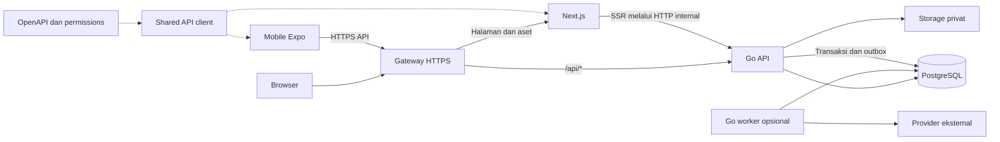

# Blueprint Monorepo Standar Berbasis Mizu

Tanggal: 22 Oktober 2026  
Status: rancangan untuk review, belum diimplementasikan  
Basis audit: Mizu commit `61a7d22`  
Tujuan: fondasi proyek baru dengan frontend Next.js, backend Go, dan mobile Expo dalam satu repository.

Keputusan pengguna: memakai Mizu sebagai basis, berbentuk monorepo, dan backend menggunakan Go. Blueprint ini menentukan arsitektur tujuan, pemilahan kode, serta roadmap menuju template yang dapat digunakan ulang. Roadmap merupakan urutan hasil dan kriteria kelulusan; rincian perubahan per commit dibuat setelah rancangan dipilih.

## 1. Hasil yang dituju dan batas versi pertama

**Core Template v1 dapat dipasang dari database kosong, memiliki identitas proyek netral, dan menjalankan frontend serta mobile melalui backend Go yang sama.** Aturan bisnis, akses database, otorisasi, integrasi bisnis, dan background job menjadi tanggung jawab Go.

Asumsi rancangan:

- Satu proyek klien memiliki deployment dan database sendiri. Multi-company dan multi-cabang didukung dalam proyek tersebut; layanan SaaS dengan tenant eksternal berbagi database tidak termasuk v1.
- Mobile v1 menjadi contoh aplikasi internal: login staf, profil, pilihan company/cabang yang diizinkan, serta daftar master data. Portal member dan OTP WhatsApp tetap tersedia sebagai calon paket opsional dari sumber Mizu.
- Pengembangan template dilakukan pada repository turunan tersendiri saat implementasi dimulai. Repository aplikasi Mizu/Paddy yang sudah ada tetap menjadi sumber modul dan histori; penghapusan dalam blueprint berarti penghapusan dari distribusi template, bukan penghapusan data produksi.
- Provider pembayaran, WhatsApp, email, dan AI tidak wajib untuk menjalankan core. Ketiadaan konfigurasinya tidak menghalangi login dan contoh modul.
- Tidak ada perubahan schema produksi atau pemindahan kode aplikasi dalam penyusunan dokumen ini.

| Termasuk Core Template v1 | Di luar Core Template v1 |
| --- | --- |
| Auth staf, session, user, role dan permission | POS dan seluruh alur pembayaran |
| Company/cabang, scope akses, profil | HRIS lengkap, payroll, accounting |
| Pengaturan brand dasar, navigasi, audit | CRM, loyalty, member spa, gym, resort |
| Upload privat dasar dan download berizin | OCR, AI, e-commerce dan integrasi marketplace |
| Satu contoh master data dengan CRUD web dan list/detail mobile | Seluruh fitur web dibuat ulang menjadi aplikasi native |
| Kontrak API, setup lokal, CI, deployment dasar | Microservices, Kubernetes, bus event eksternal, generator plugin dinamis |

Keberhasilan core tidak menunggu semua API ERP Mizu selesai distandarkan. Modul di luar core tetap disimpan di sumber Mizu dan masuk ke template hanya setelah memenuhi kontrak, dependensi, dan pengujian paketnya.

## 2. Pendekatan yang dipilih

| Pendekatan | Keuntungan | Konsekuensi | Keputusan |
| --- | --- | --- | --- |
| Ekstraksi bertahap dari Mizu menjadi core, kemudian paket ERP | Memakai kode Go yang sudah ada; hasil awal lebih kecil dan dapat diuji | Harus memetakan ketergantungan tersembunyi | **Dipilih** |
| Memindahkan seluruh Mizu ke layout baru lalu membersihkannya | Banyak fitur langsung ikut | Core tetap membutuhkan schema, seed, dan konfigurasi semua industri | Tidak menjadi jalur rilis core |
| Menulis ulang dari kosong | Struktur bebas dari warisan | Mengulang logika, tes, dan penanganan kasus nyata yang sudah tersedia | Tidak dipilih |

Backend tetap **modular monolith**: satu Go module, satu API, satu PostgreSQL. Worker adalah proses dari codebase Go yang sama ketika ada job yang memerlukannya. Komunikasi antarmodul memakai pemanggilan lokal melalui adapter atau outbox yang sudah tersedia, tanpa layanan jaringan internal per domain.

## 3. Struktur repository tujuan

Semua path dalam tree berikut merupakan **target**, belum merupakan folder yang dibuat.

```text
project-standard/
├── apps/
│   ├── frontend/                       # Next.js: web, SSR, form, navigasi
│   │   ├── src/
│   │   │   ├── app/                    # Routing dan komposisi halaman
│   │   │   ├── features/               # UI, hooks dan query per domain
│   │   │   ├── components/             # Komponen web yang benar-benar dipakai ulang
│   │   │   └── lib/                    # Adapter API, format, session UI
│   │   ├── public/brand/
│   │   ├── .env.example
│   │   ├── package.json
│   │   └── Dockerfile
│   ├── backend/                        # Go: satu go.mod
│   │   ├── cmd/
│   │   │   ├── api/                    # HTTP server
│   │   │   ├── migrate/                # Migrasi SQL dengan lock dan checksum
│   │   │   ├── seed/                   # Bootstrap core eksplisit
│   │   │   └── worker/                 # Ditambahkan saat paket job dipindahkan
│   │   ├── internal/
│   │   │   ├── app/                    # Wiring modul, adapter dan dependensi
│   │   │   ├── platform/               # DB, HTTP, auth, IAM, scope, audit, storage
│   │   │   └── modules/
│   │   │       ├── identity/           # User, login, session
│   │   │       ├── organization/       # Company, cabang dan keanggotaan
│   │   │       ├── access/             # Administrasi role dan permission
│   │   │       ├── settings/           # Pengaturan aplikasi non-rahasia
│   │   │       ├── audit/              # API pembacaan audit berizin
│   │   │       ├── files/              # Upload dan download privat
│   │   │       └── masterdata/         # Contoh kategori, lepas dari POS/HRIS
│   │   ├── database/
│   │   │   ├── migrations/core/
│   │   │   ├── migrations/modules/     # Dibuat ketika paket ERP ditambahkan
│   │   │   └── seeds/                  # Seed core dan fixture demo terpisah
│   │   ├── .env.example
│   │   ├── go.mod
│   │   ├── go.sum
│   │   └── Dockerfile
│   └── mobile/                         # Expo dan React Native
│       ├── src/app/                    # Expo Router
│       ├── src/features/
│       ├── src/components/
│       ├── src/lib/                    # API adapter dan SecureStore
│       ├── assets/brand/
│       ├── .env.example
│       └── package.json
├── packages/
│   ├── api-client/                     # Tipe generated dan fetch client web/mobile
│   └── design-tokens/                  # Warna, spacing dan token netral platform
├── contracts/
│   ├── openapi.yaml                    # Kontrak HTTP canonical untuk template
│   └── permissions.json                # Kode permission canonical, bukan grant user
├── config/
│   └── project.json                    # Nama, locale, timezone dan konfigurasi publik
├── services/                           # Opsional, tidak dijalankan oleh core
│   ├── wa-gateway/                     # Adapter provider, bila paket WA dipasang
│   ├── pos-nfc-bridge/                 # Adapter hardware, bila paket POS dipasang
│   └── pos-print-worker/               # Transport cetak, bila paket POS dipasang
├── infra/
│   ├── compose.dev.yml
│   ├── compose.prod.example.yml
│   └── gateway/                        # Routing TLS, /api ke Go, lainnya ke Next
├── scripts/                            # Doctor, dev runner, contract check, init
├── tests/e2e/                          # Alur browser ke Go ke PostgreSQL
├── docs/
│   ├── architecture/
│   ├── onboarding.md
│   ├── module-guide.md
│   ├── operations.md
│   └── upgrades.md
├── .github/workflows/
├── .env.example                        # Hanya variabel Compose/non-rahasia bersama
├── Makefile                            # Entry point lintas Go dan JavaScript
├── pnpm-workspace.yaml
├── pnpm-lock.yaml
└── package.json
```

Nama module baru seperti `organization`, `access`, dan `settings` adalah target pemisahan core dari `configuration`/`identity` yang ada. Nama 28 modul bisnis Mizu tidak perlu diganti serentak. Modul dipindahkan bila batas tanggung jawabnya memerlukannya.

### Toolchain dan dependensi

- pnpm workspace mencakup `apps/frontend`, `apps/mobile`, `packages/*`, dan layanan Node yang dipasang. Backend tidak perlu `package.json` agar bisa menjadi bagian monorepo.
- Gunakan satu `go.mod` di backend. `go.work` baru diperlukan bila nantinya ada beberapa Go module yang benar-benar independen. [Referensi Go Modules](https://go.dev/ref/mod).
- Root Makefile mengorkestrasi perintah Go dan pnpm. Turborepo tidak wajib untuk v1; tambahkan hanya jika waktu CI/build menunjukkan kebutuhan caching tambahan.
- Pertahankan `net/http`, `pgx`, `slog`, dan pola transaksi Mizu. Tidak mengganti router, ORM, atau pola dependency injection hanya untuk menyamakan gaya.
- Versi awal mengikuti basis audit: Go 1.26, Node 22, pnpm 9.15, Next 16, Expo 57. Patch yang benar-benar dirilis harus dipin setelah instalasi, pemeriksaan keamanan, dan build kompatibilitas, bukan memakai label `latest`.
- Web Mizu memakai React 19.2.4, sedangkan mobile 19.2.3. Uji resolusi workspace dan renderer sebelum memilih pin bersama; jangan memaksa override yang bertentangan dengan Expo. Pastikan satu salinan React pada setiap bundle dan tidak ada duplikasi native module. [Panduan Expo monorepo](https://docs.expo.dev/guides/monorepos/).
- UI React DOM tetap di frontend; UI React Native tetap di mobile. Hanya kontrak HTTP, fetch client yang netral platform, dan design token yang dibagi. Aturan bisnis tidak dimasukkan ke paket TypeScript bersama.

## 4. Batas tanggung jawab dan aliran data



| Area | Aturan standar |
| --- | --- |
| Frontend | Menangani presentasi, validasi kenyamanan form, state dan navigasi. Tidak mempunyai credential PostgreSQL atau query database. |
| Backend Go | Sumber kebenaran untuk validasi input, hak akses, scope, harga, stok, status transaksi, dan integrasi. |
| Mobile | Menggunakan API yang sama; token tersimpan di SecureStore. Tidak membawa secret provider atau role yang dipercaya server tanpa verifikasi. |
| Next server | Boleh memanggil Go untuk SSR dengan konteks sesi request. Tidak memanggil route handler dirinya sendiri untuk kemudian diteruskan lagi. Data pengguna tidak masuk shared cache lintas pengguna. |
| Gateway | Routing transport, TLS, batas ukuran dan timeout. Tidak memutuskan permission bisnis. |
| Layanan Node opsional | Hanya adapter protokol/perangkat yang memerlukan ekosistem Node; tidak menyimpan aturan bisnis atau mempunyai akses tulis langsung ke database ERP. |

Pemisahan SSR tersebut selaras dengan anjuran Next.js agar Server Components mengambil data langsung dari sumber, tanpa putaran melalui Route Handler sendiri. Dalam rancangan ini sumber tersebut adalah API Go. [Panduan Next.js](https://nextjs.org/docs/app/guides/backend-for-frontend).

Produksi menggunakan origin web yang sama untuk halaman dan `/api`, sehingga cookie web tetap sederhana. Pengembangan lokal boleh memakai rewrite Next ke Go, tetapi rewrite hanya meneruskan request. Mobile memakai URL HTTPS API yang dapat dijangkau perangkat. Header host/proxy dipercaya hanya dari gateway yang dikonfigurasi.

### Modul Go

Pola dasar tetap mengikuti Mizu: `module.go`, `http.go`, `service.go`, `postgres.go`, `domain/` jika ada aturan murni, dan tes yang sesuai. Jangan membuat lapisan kosong untuk CRUD sederhana. Interface dipakai pada batas dependency yang nyata, bukan untuk setiap fungsi.

- Handler melakukan decode, validasi bentuk input, auth, lalu memanggil service.
- Service memiliki aturan bisnis dan batas transaksi; repository menerima executor transaksi yang sama.
- Modul tidak mengimpor internal modul lain. Wiring/adapters berada di `internal/app`.
- Penulisan tabel milik modul lain melewati port pemiliknya. Untuk invariant yang harus atomik, adapter memakai transaksi yang sama; outbox dipakai untuk efek yang boleh selesai kemudian.
- Constraint database tetap menjadi penjaga akhir untuk keunikan, referensi, dan konsistensi yang dapat diekspresikan di database.
- Request ID, actor, company/cabang dan error dicatat dengan redaksi token/password/data sensitif.

### Auth web dan mobile

Auth staf Mizu saat ini berorientasi cookie dan token Open API; mobile yang ada memakai session member. Keduanya tidak boleh dianggap sudah menyediakan auth mobile staf yang sama.

Target core mempertahankan opaque session dengan hash token di database. Web menerima cookie `HttpOnly`, `Secure` di production, `SameSite` yang sesuai, path dan expiry eksplisit. Request mutasi berbasis cookie harus mempunyai proteksi CSRF/origin yang diuji. Mobile staf menerima opaque bearer session berjenis perangkat dari endpoint login khusus, disimpan di SecureStore, dan dapat dicabut per sesi. Tidak menggunakan token integrasi Open API sebagai pengganti login manusia.

Session memiliki expiry yang tegas, logout/revocation server, pembatas login durable, dan verifikasi status user. Header identitas aplikasi bukan bukti otorisasi. Auth mobile member/OTP tetap terpisah sebagai paket member portal; akses staf dan member tidak saling tertukar.

Default v1: session staf berakhir paling lambat 14 hari, mengikuti batas staf Mizu, dan login kembali setelah expiry; refresh-token flow tidak menjadi prasyarat. Perubahan password, penonaktifan user, dan tindakan revoke mengakhiri session terkait. Network error mobile ditampilkan sebagai status koneksi/verifikasi tertunda, bukan bukti sesi sah.

Scope kosong atau profil yang tidak ditemukan tidak memberikan akses global. Super-admin/global access harus eksplisit. Pengguna holding dibatasi daftar company dalam holding yang diizinkan. Data master global harus dinyatakan sebagai global; `NULL company_id` tidak menjadi jalan pintas untuk membuka data operasional.

### Kontrak API dan permission

Gunakan OpenAPI 3.0.3 untuk kontrak template, sesuai format yang sudah ditemukan pada bagian Mizu. `contracts/openapi.yaml` menjadi sumber kontrak transport; handler Go adalah implementasinya. Perubahan schema dan handler harus berada pada perubahan yang sama dan diverifikasi oleh contract test.

Generate tipe TypeScript memakai `openapi-typescript`, lalu gunakan fetch client tipis dengan injeksi base URL dan auth transport. Library tersebut mendukung OpenAPI 3.0 dan 3.1; pemilihan versi dependency dilakukan dan dipin pada tahap kontrak. Tipe generated tidak menggantikan validasi runtime Go. [Dokumentasi openapi-typescript](https://openapi-ts.dev/introduction).

- Kontrak core baru menggunakan `/api/v1`. Route ERP lama tetap mempertahankan path/response selama migrasi; pemetaan legacy berada pada adapter HTTP Go, bukan implementasi bisnis kedua di Next.
- Success menggunakan `data` dan `meta` untuk pagination bila relevan. Error mempunyai `code`, `message`, `request_id`, serta field error bila ada. Status 401, 403, 404, 409, 422 dan 500 dibedakan; error database internal tidak diteruskan ke pengguna.
- Timestamp dikirim dalam RFC3339; tanggal kalender tetap `YYYY-MM-DD`. Zona bisnis dikonfigurasi per proyek, default Asia/Jakarta.
- Nilai uang menggunakan decimal string dalam kontrak, PostgreSQL numeric, dan operasi desimal/fixed precision yang disepakati di Go. Perubahan rounding modul ERP lama harus melalui tes kesetaraan; jangan mengganti aturan keuangan hanya saat memindah folder.
- Kode permission berasal dari `contracts/permissions.json`, dihasilkan menjadi konstanta Go dan TypeScript. Grant user/role berada di database dan ditentukan backend. Navigasi frontend tidak menjadi sumber otorisasi.
- CI gagal bila output generate berubah tanpa di-commit, handler/contract tidak sesuai, atau perubahan kontrak merusak client versi yang masih didukung.

## 5. Database, modul opsional dan pekerjaan latar

### Membentuk database core

Mizu membawa bootstrap functions, foreign keys, views, dan trigger lintas domain. Menyalin hanya folder schema auth tidak cukup untuk menghasilkan database core yang mandiri.

Untuk **database baru template**, bentuk baseline core baru yang berisi auth, IAM, company/cabang, settings, audit, file metadata, dan contoh kategori. Tinjau FK, trigger, function dan view satu per satu; core tidak boleh mereferensikan POS, HRIS, CRM atau spa. Migrasi yang sudah diterapkan pada database Mizu tidak diubah, dipangkas, atau diberi nomor ulang.

Runner Go mempertahankan transaksi per file, advisory lock, tracking dan checksum. Tambahkan validasi perubahan checksum applied migration bila belum menolak perubahan tersebut. Daftar migrasi template dipilih secara eksplisit dari core dan modul yang dipasang, bukan menjalankan semua SQL yang ditemukan secara rekursif.

Satu katalog Go sederhana mencatat nama modul, dependensi wajib, route, job, permission dan direktori migrasinya. Identitas migrasi stabil dan unik; urutan mengikuti dependency lalu urutan file. Fitur ini tidak menjadi plugin loader dinamis. Startup menolak nama modul tidak dikenal atau dependensi/schema yang belum siap.

`MODULES=all` tidak menjadi default template. Modul yang tidak dipasang tidak membuat menu, route, seed, atau job. Menonaktifkan modul hanya menghentikan eksposur/pekerjaannya; tidak otomatis menghapus schema atau data. Bila modul yang aktif membutuhkan modul tersebut, konfigurasi ditolak.

### Seed dan konfigurasi

- `seed core`: role/permission minimum, company/cabang awal, pengaturan netral, dan bootstrap admin eksplisit. Idempoten dan tidak menimpa password/data yang sudah diubah pengguna.
- `seed demo`: fixture fiktif terpisah, hanya dapat dijalankan pada database lokal/test yang diizinkan. Tidak menjadi bagian deployment production.
- Bootstrap admin memakai password dari input aman/env atau acak satu kali, tidak memiliki password bawaan yang sama untuk semua proyek.
- Seeder core dijalankan Go/SQL. Seeder Node lama yang memerlukan Excel/provider tetap berada di sumber Mizu atau tooling migrasi khusus; tidak ikut dependency runtime template.
- `config/project.json` hanya memuat data publik. Secret backend berada di runtime env/secret store, tidak di `NEXT_PUBLIC_*`, `EXPO_PUBLIC_*`, design token, atau file brand.
- PostgreSQL tersedia hanya pada jaringan backend/worker. Role migrasi dan role runtime dipisah; frontend/mobile tidak menerima credential database.

### Job, outbox dan storage

Watcher Next di `src/instrumentation.ts` dipetakan per pemilik sebelum dinonaktifkan. Saat sebuah job dipindah, hanya satu pelaksana yang aktif selama cutover. Core tidak membutuhkan worker jika tidak ada job yang dipasang.

Paket yang membutuhkan job menggunakan `cmd/worker` dari Go module yang sama. Pertahankan outbox PostgreSQL Mizu, retry dan pencatatan kegagalan; gunakan claim/locking untuk beberapa worker. Database event dan perubahan bisnis ditulis dalam transaksi yang sama. Pengiriman eksternal bersifat at-least-once, sehingga penerima/adapter perlu idempotency; jangan menjanjikan exactly-once ke provider.

Pindahkan upload/file ownership ke Go. Local persistent volume cukup untuk deployment tunggal v1; object storage ditambahkan bila memang diperlukan. Path file tidak berasal langsung dari input pengguna. Download privat memeriksa actor dan scope, bukan hanya mengetahui URL. Volume lama dipetakan dan disalin dengan verifikasi metadata/checksum sebelum endpoint lama dihentikan.

## 6. Keputusan dipertahankan, dibuang dan direfaktor

Path sumber pada tabel merupakan path relatif terhadap root Mizu. Nama tujuan mengikuti tree di bagian 3.

| Bagian sumber | Keputusan | Perlakuan dan syarat |
| --- | --- | --- |
| `backend/cmd/api`, `backend/cmd/migrate`, `backend/go.mod` | Pertahankan | Pindah ke `apps/backend`; sesuaikan path build, embed, config dan generate tanpa sekaligus mengganti aturan bisnis. |
| `backend/internal/platform/database`, `httpx`, `safehttp`, `ratelimit`, `testutil` | Pertahankan | Gunakan komponen yang dibutuhkan core; periksa default keamanan dan hapus ketergantungan domain yang tersisa. |
| `backend/internal/platform/auth`, `scope` | Refaktor | Nama cookie netral, session staf mobile, deny untuk scope/profil yang hilang, dan hak global eksplisit. |
| `backend/internal/platform/iam` | Refaktor | Hentikan generation dari `frontend/src/lib/iam/prefixes.ts`; gunakan kontrak permission netral yang juga diuji oleh Go. |
| `backend/internal/app/module_identity.go`, `adapters_identity.go` | Refaktor | Login/profil core tidak boleh membutuhkan `configuration.warehouses`, user stall, atau POS. Pemilihan stall menjadi bagian paket POS. |
| `backend/internal/modules/configuration` | Refaktor selektif | Pisahkan company/cabang dan settings umum dari payment gateway, gudang, dan konfigurasi industri. |
| `backend/internal/platform/outbox` | Pertahankan sebagai kemampuan opsional | Pindah dispatcher ke worker ketika job dipasang; tentukan siapa mendaftarkan subscriber sebelum publisher diaktifkan. |
| Unit/integration tests Go dan tes frontend yang relevan | Pertahankan | Pindahkan bersama perilakunya, sesuaikan path. Hapus hanya tes perilaku yang memang tidak masuk distribusi tersebut. |
| `frontend/src/components/ui`, form/table/layout dan token tema | Pertahankan selektif | Ambil komponen yang dipakai core; netralkan brand, hindari membawa seluruh dashboard ERP. |
| `frontend/src/features/pos`, `hris`, `crm` dan fitur bisnis lain | Paket opsional | Tetap tersedia di sumber Mizu; masuk setelah backend Go, schema, permission dan tes paketnya siap. |
| `frontend/src/app/api`, `src/lib/db.ts`, query builder, auth server | Buang dari target setelah pengganti lulus | Inventarisasi route nyata, proxy dan stub secara terpisah. Hapus akses DB dan logika bisnis TS setelah seluruh consumer paket berpindah. |
| `frontend/src/lib/backend-routes.ts`, `go-routes.generated.json`, `api/go-only.ts` | Pensiunkan setelah cutover | Routing akhir mengirim seluruh `/api` ke Go. Tidak ada fallback bisnis ke Next jika Go tidak tersedia. Manifest route dapat tetap menjadi alat verifikasi backend. |
| `frontend/src/instrumentation.ts` | Refaktor | Tinggalkan instrumentasi web bila diperlukan; pindahkan watcher, rekonsiliasi dan job bisnis ke Go. |
| `frontend/src/lib/env.ts` | Refaktor | Frontend hanya memerlukan API origin/config web; hilangkan kewajiban `DATABASE_URL` dan secret provider. |
| OpenAPI generated dari route Next | Ganti sumber | Kontrak canonical untuk API template; dokumentasi ERP lama dipertahankan selama kompatibilitas dibutuhkan. |
| `mobile/src/lib/api.ts`, `session.ts`, `hooks/use-auth.tsx` | Refaktor | Pakai shared API client, auth staf, status expired/offline yang eksplisit; SecureStore dipertahankan. |
| Halaman mobile spa, saldo ARK, loyalty, booking eksternal | Paket member opsional | Tidak menjadi home default core; tidak menuntut CRM/spa untuk menjalankan mobile standar. |
| `backend/database/migrations` | Pisahkan baseline | Baseline baru untuk database template baru. Histori Mizu dipertahankan pada sumber; upgrade database lama adalah pekerjaan tersendiri. |
| Seeder `paddy-*`, `mizu-*`, `tedja-*`, data karyawan/spreadsheet klien | Keluarkan dari distribusi core | Simpan pada sumber klien; tidak digunakan untuk bootstrap template. |
| Logo, katalog, foto brand, copy marketing, hostname klien | Buang dari default | Ganti aset netral yang hak pakainya jelas dan satu konfigurasi brand. |
| Legacy redirect host, cookie dan label NüHabit/Arkiv/Paddy | Buang setelah kompatibilitas selesai | Template baru tidak membawa alias lama. Pada migrasi pengguna aktif, tetapkan masa transisi dan tes redirect/cookie lebih dahulu. |
| `services/wa-gateway`, `tools/pos-nfc-bridge`, print worker | Pertahankan sebagai adapter opsional | Konsumsi API Go berizin terbatas; tidak memindahkan aturan bisnis ke layanan Node tersebut. |
| `tools/deploy-mizu.sh`, `deploy-paddydev.sh`, konfigurasi tunnel klien | Ganti untuk template | Compose dan skrip deployment generik, env eksternal, health/readiness dan rollback image. |
| Desktop OS shell, gym, athlete, spa, resort, ticketing, shop, AI | Keluarkan dari core | Evaluasi paket terpisah; shell dashboard biasa menjadi navigasi awal. |
| Dependency server-only di frontend seperti `pg`, bcrypt, provider SDK, OCR/PDF | Hapus berdasarkan pemakaian | Setelah pengganti Go atau keputusan eksklusi; jangan hapus parser/generator client yang masih benar-benar dipakai UI. |

Mengeluarkan modul dari template tidak berarti modul tersebut buruk. Kriterianya adalah apakah proyek baru membutuhkan modul itu untuk login, mengelola hak akses, dan membangun fitur pertamanya.

### Paket ERP setelah core

| Paket | Kandidat sumber Mizu | Dependensi yang harus dibuktikan |
| --- | --- | --- |
| Catalog dan inventory | Inventory, item/BOM, manufacturing | Organization, master data, satuan dan gudang; pisahkan dependency purchasing yang tidak wajib |
| Procurement | Procurement | Supplier, catalog, inventory, approval dan kebutuhan accounting yang aktif |
| POS | Pos-sales, pos-ops, stored-value | Catalog, stok, pembayaran; loyalty/wallet/accounting tidak boleh diam-diam wajib bila dinonaktifkan |
| HRIS | HRIS, payroll, recruitment | Identity, organization, files; payroll/recruitment boleh menjadi paket lanjutan |
| Accounting | Accounting | Organization, fiscal period, chart of accounts; event dari POS/purchasing hanya bila paket itu aktif |
| CRM dan member | CRM, member-portal, athlete | Identity member, files, provider komunikasi; gym/spa bukan syarat login member umum |
| Industri | Spa, gym, resort, ticketing, shop | Dependensi paket yang eksplisit; brand dan fixture industri terpisah |

Tabel ini adalah target pemisahan, bukan klaim bahwa modul Mizu sudah dapat dilepas tanpa perubahan. Contohnya, wiring POS saat ini sudah menghubungkan CRM, wallet, gift card, catalog dan notifikasi; semua hubungan tersebut masuk inventory dependency.

## 7. Roadmap dan kriteria selesai

Urutan mengikuti dependency. Durasi kalender ditetapkan setelah fase 0 mengukur baseline build, tes, dan jumlah route core yang masih memerlukan Next; jumlah file bukan ukuran estimasi yang cukup.

| Fase | Hasil konkret | Kriteria selesai | Dependensi dan penanggung jawab |
| --- | --- | --- | --- |
| **0 — Baseline dan scope** | Matriks route/consumer, dependency modul/schema/job, daftar core, baseline tes, ADR arsitektur | Setiap endpoint core diklasifikasikan Go, Next nyata, proxy, atau stub. Build/tes dengan toolchain yang benar menghasilkan bukti. Risiko dan kegagalan awal dicatat. | Pertama; tech lead, backend, QA |
| **1 — Kerangka monorepo** | Repository turunan, `apps/*`, workspace pnpm, satu Go module, Makefile, environment examples, setup lokal | Frontend, Go, mobile masing-masing dapat start; root command menutup proses anak dengan benar; mobile mencapai API dari emulator/perangkat. Path test/generator/Docker tidak menunjuk lokasi lama. | Fase 0; fullstack dan DevOps |
| **2 — Core Go dan database** | Baseline SQL core, auth, organisasi, role/permission, scope, seed core, audit | Database kosong dapat login tanpa tabel spa/POS/HRIS/CRM. Uji forbidden lintas company/cabang/holding, user nonaktif, missing scope, expiry dan revocation lulus dengan PostgreSQL nyata. | Fase 1; backend dan QA |
| **3 — Kontrak dan dua client** | OpenAPI core, permission contract, generated client, dashboard web, mobile staf, contoh kategori | CRUD kategori web dan list/detail mobile memakai API yang sama. 401/403/validation konsisten; regeneration bersih; frontend/mobile tidak mempunyai credential DB. | Fase 2; backend, web, mobile |
| **4 — Mengakhiri backend ganda pada core** | Semua operasi core, upload/download dan audit dilayani Go; routing final; legacy core TS dihapus | Menjalankan web tanpa `DATABASE_URL` berhasil; saat Go mati, web menampilkan kegagalan layanan tanpa beralih ke backend TS. Tidak ada watcher bisnis Next. Upload privat diuji lintas scope. | Fase 3; fullstack, backend, QA |
| **5 — Hardening dan rilis Core v1** | CI wajib, image terpisah, smoke E2E, panduan restore, init proyek, changelog/version | Semua gate rilis di bagian 8 terpenuhi pada clean checkout. Dua contoh proyek beridentitas berbeda dapat dibuat tanpa edit source bisnis dan tanpa provider berbayar. | Fase 4; QA, DevOps, lead |
| **6 — Paket ERP bertahap** | Paket yang diprioritaskan proyek pertama; kontrak/schema/test per paket | Tiap paket dapat diaktifkan dengan dependency yang tervalidasi. Tes core tetap lulus, job tidak ganda, efek transaksi/retry teruji, modul yang tidak aktif tidak mengekspos API/menu. | Sesudah Core v1; pemilik domain |

Urutan default paket: catalog/inventory, procurement, lalu POS atau HRIS sesuai proyek pertama. Accounting dan integrasi transaksi masuk sebelum paket yang membutuhkan posting keuangan dinyatakan siap produksi. Spa/gym/resort tidak otomatis menjadi backlog wajib template.

### Migrasi satu fitur dengan aman

1. Identifikasi route, consumer web/mobile, tabel, files, permission, dan job terkait.
2. Tetapkan kontrak dan kasus penting: sukses, input salah, akses terlarang, transaksi ganda dan kegagalan provider bila relevan.
3. Reuse handler/service Go yang sudah ada; pindahkan hanya bagian yang masih berada di Next.
4. Bandingkan perilaku dengan fixture terisolasi. Jangan melakukan shadow write transaksi riil ke dua backend.
5. Alihkan consumer/routing, pantau error dan kesesuaian hasil, lalu hapus TS handler, fallback, dependency dan tes yang memang obsolete dalam paket itu.
6. Uji rollback image dengan schema kompatibel. Pengembalian image tidak dianggap otomatis mengembalikan data/database.

## 8. Syarat rilis, pengalaman developer dan operasi

### Perintah root yang harus tersedia

Nama berikut adalah kontrak tooling yang akan dibuat, belum merupakan command yang tersedia sekarang.

| Command target | Hasil |
| --- | --- |
| `make doctor` | Memeriksa versi tool, resolusi dependency, env yang wajib dan port; tidak mencetak secret |
| `make setup` | Instalasi dependency yang dipin dan membuat contoh env yang belum ada; tidak menimpa env atau menjalankan reset database |
| `make db-up` | Menjalankan PostgreSQL lokal khusus development |
| `make migrate-plan` / `make migrate-apply` | Preview/apply migrasi ke target eksplisit |
| `make seed-core` / `make seed-demo` | Bootstrap core atau fixture fiktif, dengan guard yang berbeda |
| `make dev` | Go API dan frontend; signal shutdown diteruskan ke semua proses anak |
| `make dev-mobile` | Expo secara eksplisit; tidak menganggap localhost perangkat adalah host developer |
| `make check` | Typecheck, lint, unit test dan generated-contract check |
| `make test-integration` | Go dan PostgreSQL disposable; gagal jika test DB tidak disediakan, bukan diam-diam skip |
| `make test-e2e` | Login, izin akses dan contoh CRUD browser ke API/database |
| `make build` | Build frontend production dan binary Go; mobile mempunyai pipeline build sendiri |
| `make init-project` | Mengganti identitas package/app/bundle/cookie, aset dan public config dalam checkout template baru; dry-run tersedia, tidak menyentuh database |

### Gate wajib Core Template v1

- [ ] Install berhasil menggunakan lockfile dan toolchain yang dipin dari clean checkout.
- [ ] `go vet`, pemeriksaan `gofmt`, Go unit/integration test, serta pemeriksaan race pada tes concurrency relevan lulus.
- [ ] Typecheck frontend/mobile tanpa error; build tidak menggunakan `ignoreBuildErrors`.
- [ ] Lint mencakup kode core yang didistribusikan, bukan hanya folder baru.
- [ ] Migrasi database kosong, apply kedua yang tidak mengubah apa pun, serta upgrade dari rilis template sebelumnya diuji bila sudah ada rilis sebelumnya.
- [ ] Generator permission/API client tidak menghasilkan diff tertinggal; API Go diverifikasi terhadap kontrak.
- [ ] Tes akses mencakup baca, tulis, list, export/download dan identifier milik company/cabang lain; missing profile/scope tidak membuka akses.
- [ ] Browser E2E mencakup login, logout, expiry, forbidden, validation dan CRUD contoh. Mobile diuji login, profil, list/detail, expiry, network error dan revoke pada Android/iOS.
- [ ] Web dan API production build lulus dalam CI; mobile typecheck/bundle diuji pada PR dan native build/install Android/iOS diuji sebelum tag rilis.
- [ ] Tidak ada query DB, business job atau credential DB dalam frontend/mobile; SDK provider tidak masuk client bundle.
- [ ] Pemeriksaan dependency/security Go dan JS dijalankan; temuan high/critical yang belum ditangani menghalangi rilis, kecuali pengecualian terdokumentasi dengan pemilik dan batas waktu.
- [ ] Tidak ada password default bersama, data/aset klien, endpoint production lama, atau `.env` rahasia dalam image/artifact.
- [ ] Core berjalan tanpa konfigurasi WhatsApp, pembayaran, AI dan paket industri.
- [ ] Health/readiness API, error Go mati, persistent file storage dan restore database telah diuji.
- [ ] Dua proyek contoh memiliki identitas yang berbeda dan lolos smoke test tanpa mengubah aturan bisnis core.

Tidak menetapkan persentase coverage global sebagai pengganti bukti perilaku. Prioritas pengujian adalah otorisasi/scope, transaksi, expiry/session, migrasi, file privat, dan kontrak lintas client. Paket ERP menambahkan tes idempotency pembayaran, stok bersamaan dan balancing jurnal sesuai kebutuhan domain.

### Deployment dan rilis template

Build image web dan Go terlebih dahulu, jalankan tes, kemudian jalankan migrasi sebagai satu deployment job dengan lock. Gunakan perubahan schema yang kompatibel dengan image sebelumnya; migrasi destruktif memerlukan tahap terpisah setelah consumer lama dilepas. Setelah rollout, lakukan readiness dan smoke test. Jika gagal, kembalikan image sebelumnya hanya ketika kompatibilitas schema memungkinkan; restore data mengikuti runbook yang telah diuji.

Backend dan worker memakai kode/image release yang sama bila keduanya diaktifkan. Secret diberikan saat runtime/BuildKit secret sesuai kebutuhan. Upload berada di volume persisten, bukan filesystem container sementara. Audit perubahan, backup dan uji restore mempunyai pemilik operasional.

Template diberi tag versi, changelog, serta panduan upgrade. Setiap proyek turunan mencatat versi asal template. Perbaikan inti dikembalikan ke template; penyesuaian brand dan fitur klien tetap pada proyek turunan. Upgrade dilakukan sebagai perubahan yang direview dan diuji, bukan sinkronisasi otomatis seluruh repository.

## 9. Risiko yang memengaruhi urutan pekerjaan

| Risiko | Bukti sumber | Mitigasi dalam roadmap |
| --- | --- | --- |
| Core tampak kecil tetapi masih membaca gudang/stall | `backend/internal/app/adapters_identity.go` | Fase 2 membuktikan login/profil tanpa tabel POS/gudang yang tidak diperlukan |
| Permission backend bergantung frontend | `backend/internal/platform/iam/iamgen/gen/main.go` | Kontrak permission netral pada fase 2–3; backend build/test tidak memerlukan source frontend |
| Menonaktifkan route dianggap sudah mematikan modul | `backend/internal/platform/config/config.go`, wiring `internal/app` | Dependency catalog, migrasi terpilih, dan job/route registry diuji bersama |
| Go aktif tetapi Next tetap melakukan job/database work | `frontend/src/instrumentation.ts`, `src/lib/env.ts` | Fase 4 membuktikan frontend berjalan tanpa akses PostgreSQL |
| Mobile dianggap siap untuk semua identitas | `mobile/src/lib/api.ts`, `backend/internal/platform/auth/session.go` | Auth staf mobile dikerjakan eksplisit; session member tidak digunakan sebagai session staf |
| Scope kosong berarti akses global | `backend/internal/platform/scope/scope.go` | Default deny dan tes lintas company/holding sebelum merilis core |
| Dua backend menjadi sumber perilaku yang berbeda | `frontend/src/lib/backend-routes.ts`, `api/go-only.ts` | Route inventory per method, contract test dan penghapusan fallback bertahap |
| Baseline database membawa FK/function industri | `backend/database/migrations/bootstrap` | Baseline baru hanya untuk DB template baru; migrasi legacy tetap pada sumber Mizu |

Keputusan implementasi berikutnya adalah memulai **fase 0**, kemudian membangun satu alur core dari login sampai contoh master data pada frontend dan mobile. Alur tersebut menjadi bukti bahwa struktur, auth, kontrak, database, dan CI sudah cocok sebelum memindahkan modul ERP yang lebih kompleks.
